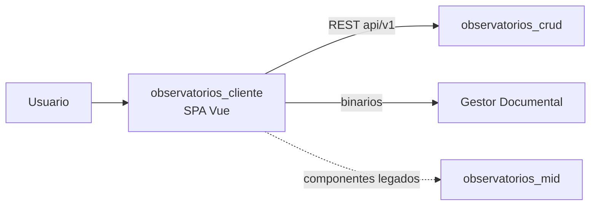

# Arquitectura e integraciones — observatorios_cliente

> Estado: resumen histórico consolidado. La fuente canónica es
> [`sdd/arquitectura-as-is.md`](sdd/arquitectura-as-is.md).

## Arquitectura del repositorio
- Stack: Vue 3 + Vite + Vuetify + Pinia + Vue Router.
- Patrón principal: SPA con capa de servicios HTTP por dominio funcional.

## Diagrama de contexto

## Contratos e interacciones esperadas
| Sistema destino | Propósito | Evidencia técnica |
|---|---|---|
| `observatorios_crud` | CRUD de entidades del dominio observatorios | Variables de entorno/front y servicios axios |
| Gestor Documental | Binarios: alta, consulta y eliminación | `gestorDocumentalService.js`, tablero y visor |
| `observatorios_mid` | Flujo anterior no configurado | Componentes `archivos/` con base vacía |

## Riesgos técnicos
- Configuración de endpoints de ambiente no centralizada completamente.
- Mezcla de `fetch` y `axios` (estandarización pendiente).
- Contratos de error entre cliente y backend no formalizados en una especificación única.

## Entregables SDD

- [Servicios y estado](frontend/servicios-y-estado.md).
- [Brechas y riesgos](sdd/brechas-y-riesgos.md).
