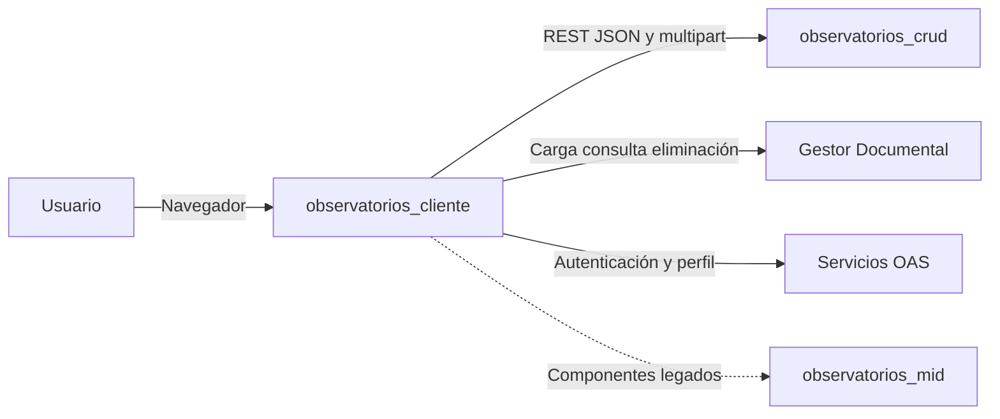
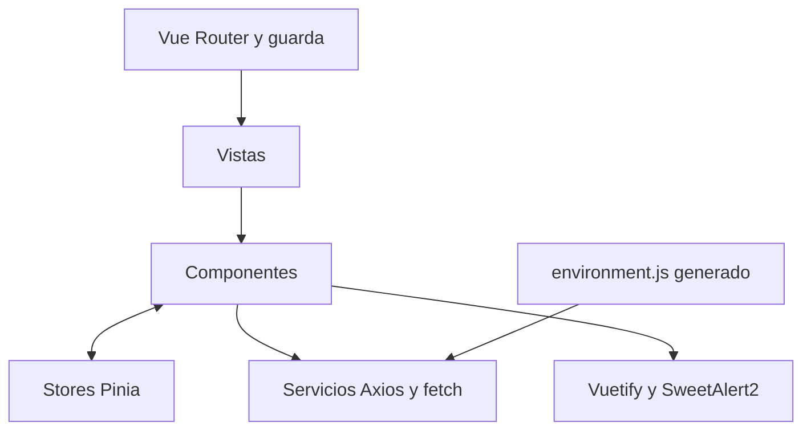
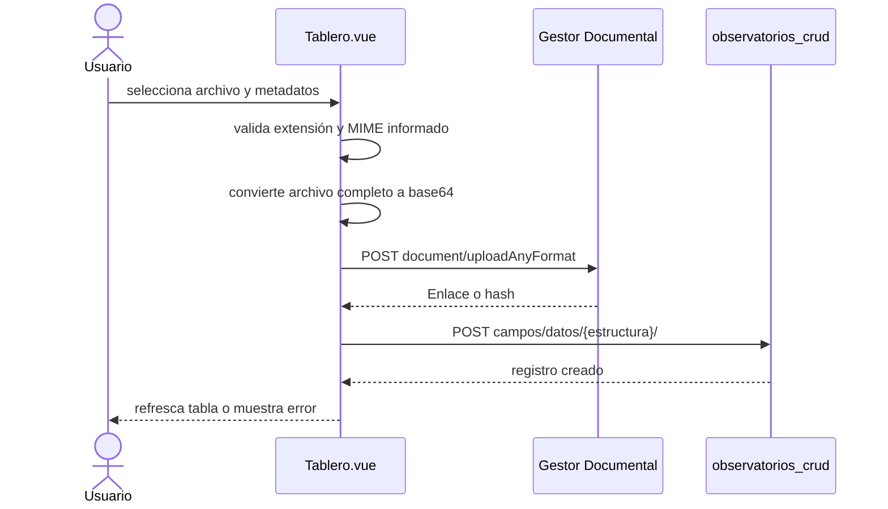
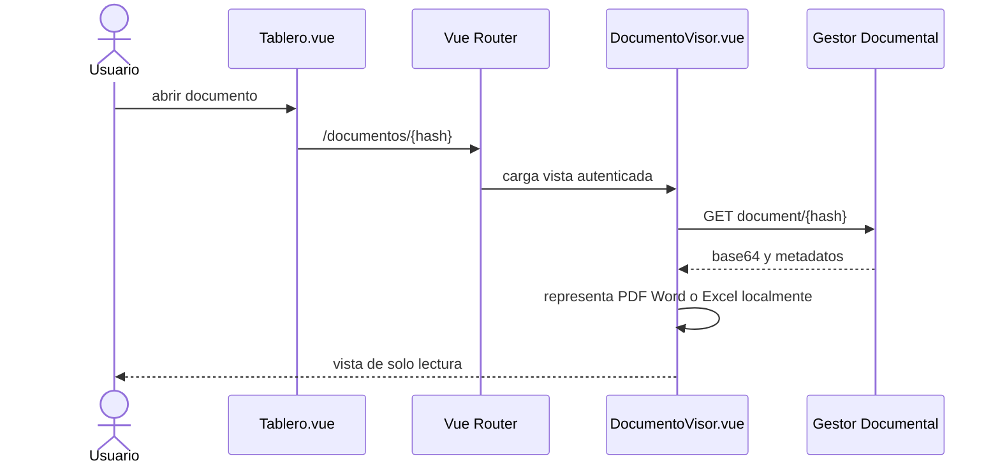

# Arquitectura AS-IS

## Referencia

Inspección de `observatorios_cliente@8537cb7104042cb1bd7874bb0d3cf8baa991d45e`
el 2026-11-10. Se aplican conceptos de C4 y vistas de ISO/IEC/IEEE 42010 sin
declarar conformidad.

## Contexto

- [VERIFICADO] CRUD y Gestor son integraciones activas.
- [VERIFICADO] MID permanece en componentes legados con base vacía.
- [NO VERIFICADO] Implementación y controles internos de Gestor/OAS.

## Contenedor SPA

| Componente | Responsabilidad | Evidencia |
|---|---|---|
| `router/index.js` | Rutas, redirecciones, token, rol e hidratación de factor | `src/router/index.js` |
| `views/` | Entradas asociadas a navegación | `src/views/*.vue` |
| `components/` | Flujos y formularios por dominio | `src/components/**` |
| `service/` | Clientes HTTP y adaptación parcial | `src/service/*.js` |
| `stores/` | Contexto de usuario, factor, estructura, observatorio, panel y gráfica | `src/stores/*.js` |
| `environments/` | URLs y configuración pública por ambiente | scripts de `package.json` |

## Secuencia de carga documental activa

[VERIFICADO] No hay límite de tamaño en el cliente. [INFERIDO] si el último POST
falla queda un archivo huérfano, porque el flujo de alta no compensa esa ruta.

## Secuencia de visualización

## Estado y acceso

- [VERIFICADO] La guarda espera token hasta 2 segundos y luego usuario hasta 2
  segundos (`router/index.js:180-201`).
- [VERIFICADO] `localStorage` o `sessionStorage` habilitan navegación, pero la
  mayoría de clientes CRUD solo adjunta el primero.
- [VERIFICADO] Las rutas permitidas y la regla `to.path.includes("/panel")` no son
  equivalentes a autorización por operación.
- [VERIFICADO] La guarda hidrata el factor desde el servicio; si falla crea un
  objeto mínimo y permite continuar.
- [VERIFICADO] Stores de panel y gráfica persisten; el de observatorio no, aunque
  varias vistas de panel dependen de él.

## Límites y deuda arquitectónica

- Ocho instancias Axios y seis interceptores repiten autenticación.
- Componentes contienen orquestación HTTP, compensaciones y presentación.
- Flujos vigentes y legados coexisten en rutas y componentes.
- Errores pueden mostrarse en el helper y otra vez en el consumidor.
- [NO VERIFICADO] No hay ADR que formalicen estas decisiones.

## Correspondencias

- Navegación: [`../frontend/navegacion-y-modulos.md`](../frontend/navegacion-y-modulos.md).
- Servicios y estado: [`../frontend/servicios-y-estado.md`](../frontend/servicios-y-estado.md).
- Accesibilidad: [`../frontend/experiencia-y-accesibilidad.md`](../frontend/experiencia-y-accesibilidad.md).
- Integraciones: [`matriz_interacciones.md`](matriz_interacciones.md).
- Riesgos: [`brechas-y-riesgos.md`](brechas-y-riesgos.md).
