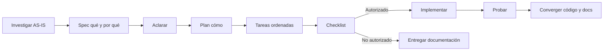

# Flujo Spec-Driven Development

## Ciclo

## Puertas de calidad

| Fase | Debe demostrar |
|---|---|
| Investigación | Commit, ruta, rol, componente, store/servicio, proveedor y estado activo/legado |
| Spec | Alcance, REQ, BR, AC, contratos y NFR sin métricas inventadas |
| Aclaración | Ambigüedades críticas resueltas o bloqueo visible |
| Plan | Impacto UI/API/datos/seguridad/accesibilidad, pruebas y rollback |
| Tareas | Dependencias, archivos y validación por tarea |
| Checklist | Compatibilidad, trazabilidad y documentación cruzada |
| Implementación | Autorización explícita; una plantilla no la concede |
| Verificación | Comandos y resultados reales; pruebas omitidas declaradas |
| Convergencia | Matrices, specs y AS-IS coinciden con el comportamiento entregado |

## Lenguaje y referencias

`MUST`, `SHOULD` y `MAY` son normativos según BCP 14 solo si la spec TO-BE lo
declara. ISO/IEC/IEEE 29148, ISO/IEC/IEEE 42010, ISO/IEC 25010, WCAG 2.2 y OWASP
se usan como guías de calidad, no como certificación.

## Artefactos

Las plantillas están en `../specs/plantillas/`. La spec define qué/por qué; el plan
define cómo; las tareas ordenan ejecución; el checklist controla entrada y salida.
Los IDs AS-IS no se reciclan para cambios deseados.
